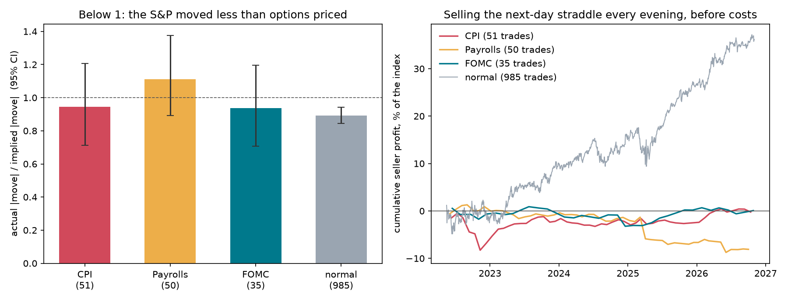
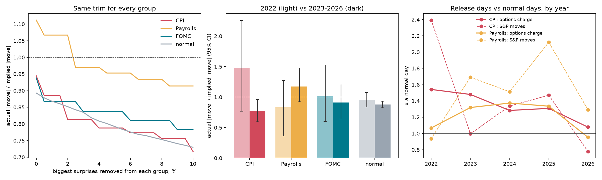
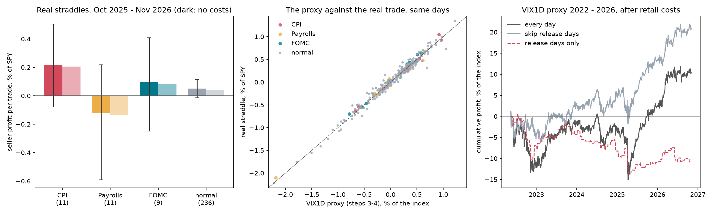
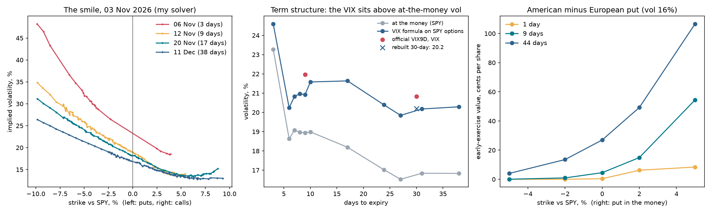
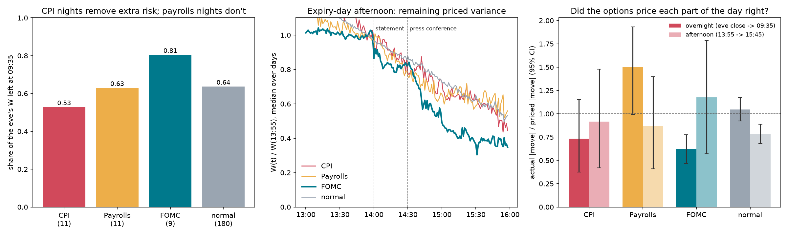

# Do Options Overprice Macro News?

[](https://github.com/unaifmm/options-event-risk/actions/workflows/tests.yml)

[](LICENSE)

**SPY options around CPI, payrolls and FOMC decisions, 2022-2026: what they charge, what happens, and when the risk leaves the price.**

The evening before a CPI release, a jobs report or a Fed decision, options on the S&P 500 get more expensive: the market pays for protection against a big move. This project asks whether that protection is overpriced, as option prices usually are, or fairly priced. It uses 4.5 years of VIX1D (the options market's expected move for the next day), a year of real 1-minute prices of SPY options expiring the next day, and an option pricer written from scratch and checked against the data vendor to the sixth decimal.

*Unai Fueyo Montalvo · BSc Economics, Universidad Autónoma de Madrid · [LinkedIn](https://www.linkedin.com/in/unai-fueyo-montalvo-63823339b)*

**Read the paper:** [full paper (PDF, 9 pages)](docs/Options_Event_Risk_paper.pdf) · [one-page summary (PDF)](docs/Options_Event_Risk_summary.pdf)

## Key findings

1. **Normal days: options are overpriced.** The S&P 500 moves 0.89 times what options priced [95% CI 0.84, 0.94] over 985 days. Selling the next-day straddle earns about +0.04% of the index per trade and wins 62% of days. This holds on every check: averages, medians, trimming the biggest days, both periods.
2. **Release days: the premium shrinks.** On CPI, payrolls and FOMC days options charge 27% more than on normal days, but the S&P moves 43% more (medians: 26% and 44%). The direction holds on every check. The difference is not statistically significant overall (rank test p = 0.19).
3. **Payrolls is the event options miss.** Overnight before the open, options price almost no extra risk for the 08:30 jobs report (the variance gone by 09:35 is the same as on a normal night), yet the S&P moves 1.5 times what was priced. Over 2022-26, payrolls days move 1.11 times their price; the result survives removing the tariff crash of 4 April 2025, trimming and medians (rank test p = 0.06).
4. **CPI flipped.** In the 2022 inflation shock, CPI days moved 1.48 times their price. Since 2023 they move 0.78 times [0.60, 0.96]: CPI options have been overpriced, while the premium they charge over a normal day fell from 1.5 to 1.1 times.
5. **The trade.** On real SPY straddles (Oct 2025 - Nov 2026) retail costs take 0.011% of SPY per trade, small next to the edge. Over 2022-26, selling every day has a Sharpe ratio of 0.23 after costs and a worst drawdown of 16% of the index; **skipping release days doubles the Sharpe (0.52) and halves the drawdown (8.6%)**.
6. **For the Fed, the risk leaves during the press conference.** At 14:05, just after the 14:00 statement, 89% of the variance priced at 13:55 is still there; at 15:00, after the 14:30 press conference starts, 49% (normal days at 15:00: 73%).
7. **The tools.** My Black-Scholes pricer matches the vendor's implied volatility on 46,816 option-minutes to within 0.00004 volatility points. With the CBOE's own formula on SPY options it rebuilds the VIX at 20.2 (official: 20.8).



---

## Research questions

1. **Pricing.** Do options charge too much for the next day's move on release days, as they do on normal days?
2. **Robustness.** Is the answer a handful of extreme days?
3. **Tradability.** Can the premium be earned on real SPY options after costs, and at what tail risk?
4. **Timing.** When does the event risk leave option prices: overnight for 08:30 releases, at the 14:00 statement or the 14:30 press conference for the Fed?

## Data

| Source | What | Period |
|---|---|---|
| [Cboe](https://www.cboe.com/tradable_products/vix/) | Daily VIX1D, VIX9D, VIX and VIX3M | May 2022 - Nov 2026 |
| [FRED](https://fred.stlouisfed.org) (St. Louis Fed) | S&P 500 daily close, 3-month T-bill rate | same |
| London Strategic Edge | SPY 1-minute bars; 1-minute candles of SPY calls and puts at the 3 strikes around each eve's close, expiring the next day; minute implied volatility and Greeks on release days; a snapshot of the whole chain (3 Nov 2026); US macro calendar | SPY from 2022; options Oct 2025 - Nov 2026 |
| dividendranks.com, chartrow.com | SPY's quarterly dividends (ex-dates and amounts), for put-call parity | 2025 - 2026 |

Raw data is not included in the repository (size and the vendors' terms); `01_download_data.py` rebuilds it.

**The trade studied.** At the eve's close, buy (or sell) the at-the-money SPY call and put that expire at the next day's close: a *straddle*. It pays |SPY at expiry - strike|, so its price is the move the market charges for. For a normal distribution the average absolute move is 0.80 times the standard deviation, so VIX1D implies an absolute move of 0.80 x VIX1D / sqrt(252). On real straddles the price is 0.94 times that (step 2, correlation 0.971), the factor used to turn 4.5 years of VIX1D into straddle prices.

## Validation first: data problems found and fixed

| Problem | How it was found | Fix |
|---|---|---|
| SPY downloads failed: the vendor resolved "SPY" to a paid Nasdaq feed | `[403] feed requires subscription` | Ask for the free `us_stocks` dataset by name |
| The catalogue lists SPY option trades since 2014, but 1-minute option candles exist only from October 2025 | Asked the vendor for a size estimate month by month before downloading anything (`step0c_coverage.py`) | Real options for Oct 2025 - Nov 2026; VIX1D for May 2022 - Nov 2026, checked against the real straddles on the 266 days they overlap: correlation 0.989 |
| Put-call parity was off by +$0.11 on most days and about -$1.70 on four | Parity check at the eve's close (`02_data_checks.py`) | Two real effects: interest on the strike over the T+1 settlement gap (three days on **Thursday** eves, because Friday's exercise settles on Monday) and SPY's dividend. Accounting for both: median gap 2 cents, 91% within 25 cents (`src/parity.py`) |
| Half days close at 13:00 | 4 eves or expiries with the last bar before 15:59 | Left out; the pricer uses the 13:00 close (with a 16:00 clock, implied volatility for the 27 Nov 2026 expiry would be 0.04 points off) |
| One of the worst "payrolls" days, 4 Apr 2025, was really the tariff crash | China announced 34% retaliatory tariffs that morning | Not deleted: every robustness check applies the same rule to every kind of day (`04_robustness.py`) |
| No bid/ask quotes, only trades | The option data has trade prices only | Costs as scenarios anchored on the data: at expiry, options trade a median 1-2 cents above intrinsic value |

## Results

### 1. VIX1D vs the S&P 500's actual moves (`03_long_sample.py`, May 2022 - Nov 2026)

| | Days | Implied \|move\| | Actual \|move\| | Actual / implied [95% CI] | Seller per trade (no costs) |
|---|---|---|---|---|---|
| CPI | 51 | 1.04% | 0.98% | 0.94 [0.71, 1.21] | -0.004% |
| Payrolls | 50 | 0.94% | 1.05% | 1.11 [0.89, 1.38] | -0.162% |
| FOMC | 35 | 0.97% | 0.91% | 0.94 [0.71, 1.20] | +0.002% |
| Normal | 985 | 0.78% | 0.69% | **0.89 [0.84, 0.94]** | +0.037% |

A clock check confirms the releases are priced as events: VIX1D falls from 17.4 to 14.1 across a CPI day and from 17.5 to 14.6 across a payrolls day, and stays flat on normal days (13.6 to 13.8).

### 2. Is it a handful of days? (`04_robustness.py`)

| Check | CPI | Payrolls | FOMC | Normal |
|---|---|---|---|---|
| All days | 0.94 | 1.11 | 0.94 | 0.89 |
| Biggest 5% of surprises removed from each group | 0.79 | 0.95 | 0.84 | 0.79 |
| Median day (fair under normality: 0.85) | 0.80 | 0.99 | 0.79 | 0.73 |
| Rank test vs normal days, p | 0.52 | 0.06 | 0.51 | |
| Without the single most important day | 0.88 | 1.02 | 0.87 | 0.89 |
| 2022 | 1.48 [0.77, 2.26] | 0.83 | 1.01 | 0.95 |
| 2023 - 2026 | **0.78 [0.60, 0.96]** | 1.17 [0.93, 1.48] | 0.91 | 0.88 [0.83, 0.93] |

The 2022 / 2023-26 split was chosen after seeing the year-by-year numbers, so the CPI "flip" is a hypothesis for new data to test, not a confirmed result.



### 3. The real trade (`05_straddles.py`, 267 SPY straddles, Oct 2025 - Nov 2026)

Sell at the eve's last trade (15:59), pay |SPY close - strike| at expiry. Costs per option traded: 1 cent of half-spread + $0.20 a contract (professional), 2 cents + $0.70 (retail); three options per straddle.

| | Days | Before costs [95% CI] | After retail costs | $ per straddle (retail) |
|---|---|---|---|---|
| CPI | 11 | +0.218% [-0.079, +0.505] | +0.206% | +138 |
| Payrolls | 11 | -0.124% [-0.592, +0.219] | -0.135% | -103 |
| FOMC | 9 | +0.094% [-0.248, +0.408] | +0.083% | +59 |
| Normal | 236 | +0.051% [-0.014, +0.114] | +0.040% | +28 |

| Strategy, after retail costs | Sharpe | Worst day | Worst 5% of trades | Worst drawdown |
|---|---|---|---|---|
| **VIX1D 2022 - 2026:** sell every day | 0.23 | -5.63% | -1.69% | -16.3% |
| skip release days | **0.52** | -5.63% | -1.55% | **-8.6%** |
| release days only | -0.49 | -4.58% | -2.64% | -13.9% |
| **Real straddles 2025 - 2026:** sell every day | 1.28 | -2.23% | -1.29% | -3.5% |

The real year was calm; the 4.5-year numbers are the honest ones. The worst day, 9 Apr 2025 (the tariff pause, S&P +9.1%), cost a seller 5.6% of the index, about eight days of premium. Removing the four days whose put-call parity is off by more than $0.50 changes nothing.



### 4. The pricer (`06_black_scholes.py`, `src/bs.py`)

Black-Scholes price and Greeks, implied volatility by bisection (it always converges because the price rises with volatility) and a binomial tree for American options, tested against Hull's textbook examples.

- **Against the vendor:** on 46,816 option-minutes (31 release days) my implied volatility differs by a median 5e-7 volatility points (largest 3e-5) and the Greeks by 1e-7: the vendor uses exactly this model. On the chain snapshot (2,457 options, 16 expiries) everything is within the vendor's rounding.
- **Early exercise** (American minus European on the same tree): 0.4 cents for this study's 1-day at-the-money options, under 0.1% of the straddle; it matters for deep in-the-money puts, which gain about a day of interest on the strike.
- **The smile:** for 9-day options, a put 10% below SPY is priced at 35% volatility, at the money 19%.
- **A rebuilt VIX:** the CBOE formula on SPY options gives 20.2 for 30 days (official VIX 20.8) and 20.9 for 9 days (VIX9D 22.0). Both sit above at-the-money volatility (by about 2 points at 9 days and 3.4 at 30 days), because the VIX prices the whole smile, including crash protection.



### 5. When does the risk leave the price? (`07_intraday.py`, 211 expiry days with a one-night eve)

W = implied volatility squared x time to expiry is the variance the options price until the close, computed each minute from the out-of-the-money option with my own solver (within 1.4% of the vendor's).

| | Days | W left at 09:35 (share of the eve's) | Overnight move / priced [95% CI] | Afternoon 13:55 - 15:45 move / priced |
|---|---|---|---|---|
| CPI | 11 | 0.53 | 0.73 [0.38, 1.15] | 0.92 |
| Payrolls | 11 | 0.63 | **1.50 [0.99, 1.93]** | 0.87 |
| FOMC | 9 | 0.81 | 0.62 [0.47, 0.77] | 1.17 [0.57, 1.78] |
| Normal | 180 | 0.64 | 1.04 [0.92, 1.18] | 0.78 [0.68, 0.89] |

CPI nights remove 11 points more of the eve's variance than a normal night (about a 0.24% move priced for the release); payrolls nights remove 1 point more. On FOMC days, W relative to 13:55 is 0.89 at 14:05, 0.76 at 14:35, 0.49 at 15:00 and 0.37 at 15:30.



## Limitations

- **Small samples on release days**: 50 per type over 4.5 years, 9-11 with real option prices. Confidence intervals are wide and shown everywhere.
- **The long sample uses VIX1D, not traded straddles.** It is built from S&P 500 index options rather than SPY options; the 0.94 bridge is measured on one year, with a range of 0.83-1.08, and the seller's absolute profit depends on it (comparisons between kinds of days do not).
- **Trades, not quotes.** Costs are scenarios. Market makers who earn the spread do better; wider spreads on volatile days would do worse.
- **Selling straddles carries large tail risk.** The Sharpe ratios above say nothing about the margin needed to survive days like 9 April 2025.
- **The 2022 / 2023-26 split was chosen after looking.** It is a hypothesis to check on 2027 data.

## How to run

```bash
python -m venv .venv
.venv\Scripts\activate            # Windows (macOS/Linux: source .venv/bin/activate)
pip install -r requirements.txt
lse auth YOUR_KEY                 # London Strategic Edge (SPY, options, calendar)
python run_all.py --download      # first time: download, then run every step. The option candles take
                                  # several days on the free plan: re-run until it says everything is done
python run_all.py                 # later: re-run the analysis on the data you have (about 3 minutes)
```

The unit tests (`python -m pytest`, a few seconds, 26 tests) need no data and no key; they run on GitHub at every change.

## Project structure

```
├── step0_data_check.py         step 0: what data exists? (one-off checks, write data_check/)
├── step0b_options_check.py     step 0b: which option data the vendor really has
├── step0c_coverage.py          step 0c: from when (size estimates only, nothing downloaded)
├── 01_download_data.py         Cboe, FRED, macro calendar, SPY, SPY options, chain snapshot
├── 02_data_checks.py           coverage, stale prices, put-call parity, expiry prices, the VIX1D bridge, clocks
├── 03_long_sample.py           VIX1D vs actual moves, May 2022 - Nov 2026
├── 04_robustness.py            trims, medians, rank tests, leave one out, two periods, the bridge
├── 05_straddles.py             the real trade: costs, strategies, tail risk
├── 06_black_scholes.py         my pricer vs the vendor, early exercise, the smile, a rebuilt VIX
├── 07_intraday.py              implied variance minute by minute: releases overnight, the FOMC afternoon
├── run_all.py                  one command: tests + every step in order
├── src/
│   ├── config.py               folders, sample, sources, SPY dividends
│   ├── bs.py                   Black-Scholes, Greeks, implied volatility, binomial tree
│   ├── parity.py               put-call parity: T+1 settlement days, interest, dividends
│   ├── days.py                 release labels; the market clock (13:00 early closes, time to expiry)
│   ├── stats.py                bootstrap, trimming, Sharpe, drawdown, expected shortfall
│   ├── options.py              option tickers, downloads, candles
│   ├── cboe.py, fred.py        daily volatility indices, S&P 500 and T-bill rate
│   ├── spy.py                  SPY minute bars and daily closes
│   ├── lse.py, events.py       London Strategic Edge download and macro releases (from project 1)
│   └── webapi.py               polite JSON client (from project 2)
├── docs/                       the paper and its one-page summary
├── tests/                      unit tests (pytest), no data needed
├── figures/                    output charts
└── results/                    output tables (CSV)
```

## Related projects

- [Do Prediction Markets Know What the Fed Will Do?](https://github.com/unaifmm/prediction-markets-fed): Kalshi and Polymarket vs futures, FX and T-bills around the same releases.
- [Who Moves First?](https://github.com/unaifmm/information-diffusion-nasdaq-sp500): information diffusion between Nasdaq-100 and S&P 500 futures and ETFs.

## Versions

- **v1.0** (Nov 2026): first release, with the paper and the one-page summary. Data downloaded on 4 November 2026.

## License

Code: MIT (see `LICENSE`). Data is not included; it belongs to its providers.

## References

- Bakshi, G. & Kapadia, N. (2003). Delta-hedged gains and the negative market volatility risk premium. *Review of Financial Studies*, 16(2), 527-566.
- Black, F. & Scholes, M. (1973). The pricing of options and corporate liabilities. *Journal of Political Economy*, 81(3), 637-654.
- Carr, P. & Wu, L. (2009). Variance risk premiums. *Review of Financial Studies*, 22(3), 1311-1341.
- Cboe Global Markets. *Cboe Volatility Index (VIX) white paper* (the VIX formula used in `06_black_scholes.py`).
- Cox, J. C., Ross, S. A. & Rubinstein, M. (1979). Option pricing: A simplified approach. *Journal of Financial Economics*, 7(3), 229-263.
- Dubinsky, A., Johannes, M., Kaeck, A. & Seeger, N. J. (2019). Option pricing of earnings announcement risks. *Review of Financial Studies*, 32(2), 646-687.
- Hull, J. C. *Options, Futures, and Other Derivatives*. Pearson (the textbook examples in `tests/test_bs.py`).
- Lucca, D. O. & Moench, E. (2015). The pre-FOMC announcement drift. *Journal of Finance*, 70(1), 329-371.
- Merton, R. C. (1973). Theory of rational option pricing. *Bell Journal of Economics and Management Science*, 4(1), 141-183.
- Savor, P. & Wilson, M. (2013). How much do investors care about macroeconomic risk? Evidence from scheduled economic announcements. *Journal of Financial and Quantitative Analysis*, 48(2), 343-375.

*For research and educational purposes only; not investment advice. The Python code was written with the help of AI coding assistants; the research questions, design and interpretation are the author's.*
